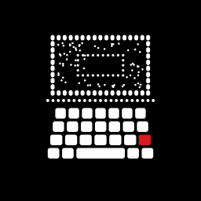
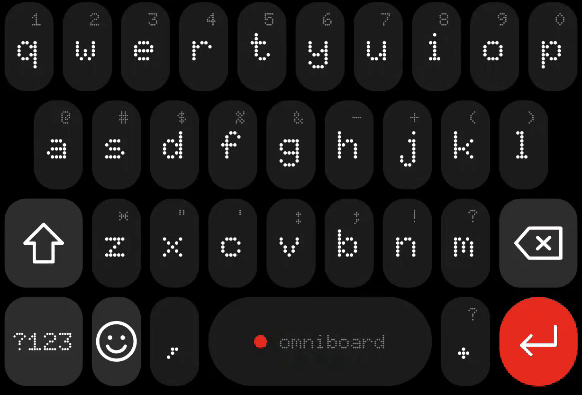
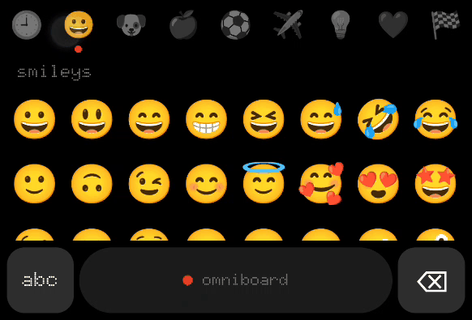
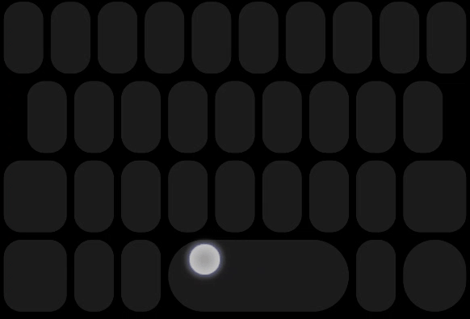
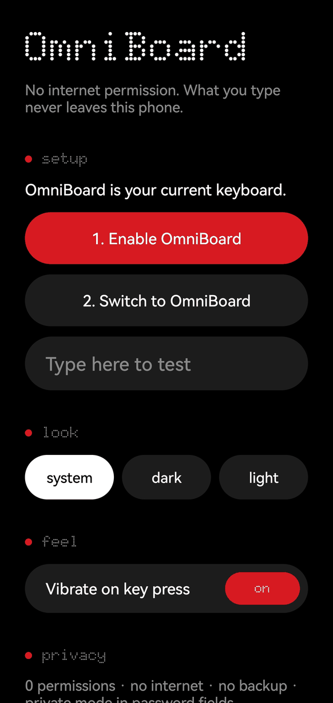

<p align="center">
  
</p>

<h1 align="center">OmniBoard</h1>

<p align="center">
  Tiny, private keyboard for Android. Nothing-style design, zero permissions, no internet.
</p>

<p align="center">
  <a href="https://github.com/andrasulthan-alt/OmniBoard/releases/latest"></a>
  
  
  
</p>

<p align="center">
  
  
  
</p>

## Features

**Typing**
- QWERTY with shift and caps lock (double-tap shift)
- Long-press a letter for numbers and symbols
- Two symbol pages: tap `?123` for numbers and common symbols, then `=\<` for = [ ] { } < > \ | ~ ^ ° £ € ¥ and more
- Hold `+` for `=`, hold `-` for `_`
- Smart enter key: search, go, send, next, done
- Auto-capitalize sentences (can be turned off)

**Emoji**
- Tap the smiley key next to `?123`
- Recent, smileys, nature, food, activity, travel, objects, symbols and flags
- Uses your phone's own emoji, so the app stays small. Emoji your phone can't show are hidden

**Space-bar trackpad**
- Hold the space bar, or swipe it sideways, to move the text cursor
- Letters fade out and the keys turn into a trackpad, like on iPhone
- Move up or down to change lines

**Look and feel**
- Dot-matrix font, thin icons, pill-shaped space and enter keys, one red accent
- Dark, light, or follow the system
- Vibrate on key press (can be turned off)
- Hold the emoji key to switch to another keyboard

## Settings



Open the OmniBoard app to:

1. Enable OmniBoard
2. Switch to OmniBoard
3. Try it in the test field
4. Pick a theme
5. Turn vibration and auto-capitalize on or off

The privacy section shows what the app can and can't do.

<br clear="right">

## Privacy

- **0 permissions**: no internet, no contacts, no location, no storage
- No Google Play Services, no ads, no trackers, no analytics
- No cloud backup and no device-to-device transfer of keyboard data
- Recent emoji are stored only on your phone
- In password fields nothing is remembered, the red dot on the space bar turns hollow, and the trackpad never reads the field
- Nothing you type ever leaves your phone

## Install

- **GitHub**: download the latest APK from [Releases](https://github.com/andrasulthan-alt/OmniBoard/releases/latest)
- **Obtainium**: [add OmniBoard to Obtainium](https://apps.obtainium.imranr.dev/redirect.html?r=obtainium://add/https://github.com/andrasulthan-alt/OmniBoard), or paste `https://github.com/andrasulthan-alt/OmniBoard` in **Add App**
- **Komi Store**: search for OmniBoard

Then open OmniBoard, tap **Enable OmniBoard**, then **Switch to OmniBoard**.

Updates install over earlier versions, no need to uninstall. Requires Android 8.0 or newer.

## Verify the APK

Releases are signed with this certificate (SHA-256):

```
6F:47:19:47:21:4C:57:B7:F4:62:D3:58:6B:5D:99:63:B0:01:D2:55:7B:2A:E5:5E:F2:01:AB:36:26:BC:67:8B
```

## Build

Every push to `main` builds a release APK with GitHub Actions. Publishing a release attaches the signed APK to it. The project is plain Kotlin with no third-party libraries.

## Credits

- Font: [Doto](https://github.com/oliverlalan/Doto) by Óliver Lalan, SIL Open Font License 1.1
- Inspired by the Nothing OS design language. Not affiliated with Nothing Technology.

## License

GPL-3.0
